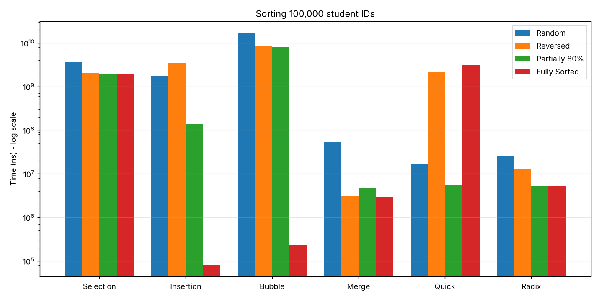

# Benchmark-Algorithms-Sorting

## 1) البيانات الشخصية
| الحقل | القيمة |
|---|---|
| اسم الطالب | ______________ |
| الرقم الجامعي | ______________ |
| رقم الشعبة | ______________ |

## 2) المثال الواقعي
ترتيب **100,000 رقم قيد جامعي** (8 خانات، مثل `20231547`) — مفاتيح ثابتة الطول، وهي الحالة المناسبة لـ Radix Sort.
الخوارزميات: Selection, Insertion, Bubble, Merge, Quick + **Radix Sort (LSD)**. القياس بـ `System.nanoTime()` للترتيب فقط (بدون النسخ أو التعبئة)، مع نسخة مستقلة لكل تجربة والتحقق من صحة الترتيب خارج الزمن.

تشغيل: `java -Dfile.encoding=UTF-8 SortBenchmark.java`

## 3) جدول النتائج (نانوثانية ns)
| الخوارزمية | Random | Reversed | Partially (80%) | Fully Sorted |
|---|---:|---:|---:|---:|
| Selection | 3,694,185,837 | 2,000,816,418 | 1,875,456,437 | 1,922,445,506 |
| Insertion | 1,725,383,949 | 3,451,383,023 | 137,642,624 | 81,479 |
| Bubble | 16,832,246,110 | 8,370,934,965 | 8,012,245,626 | 230,909 |
| Merge | 52,522,005 | 3,090,888 | 4,792,484 | 2,911,028 |
| Quick | 16,811,716 | 2,176,355,057 | 5,437,230 | 3,150,263,463 |
| **Radix** | 24,797,601 | 12,572,118 | 5,310,764 | 5,362,910 |

بالميكروثانية (µs): اقسم على 1000. (الأزمنة تختلف قليلاً من جهاز لآخر ومن تشغيل لآخر.)

## 4) الرسم البياني (مقياس لوغاريتمي)

## 5) التحليل والمناقشة

**O(N²) مقابل O(N log N):** في الحالة العشوائية احتاج Bubble ≈ 16.8 ثانية وSelection ≈ 3.7 ثانية وInsertion ≈ 1.7 ثانية، بينما Merge ≈ 52 ms وQuick ≈ 17 ms وRadix ≈ 25 ms؛ أي الفرق مئات إلى آلاف المرات عند N = 100,000 (≈10¹⁰ عملية مقابل ≈1.7×10⁶).
Selection يبقى تقريبًا ثابتًا (≈2–3.7 ث) في كل الحالات لأنه يبحث عن الأصغر دائمًا في كل الجزء غير المرتب مهما كانت البيانات.

**الأفضل في المرتبة والمرتبة جزئيًا:**
- *المرتبة تمامًا:* Insertion (≈81 µs) وBubble مع علم `swapped` (≈231 µs) هما الأفضل لأنهما O(N) — تمريرة واحدة بدون إزاحة/تبديل.
- *المرتبة جزئيًا (80%):* Merge وQuick وRadix (≈5 ms) متقاربة وهي الأفضل مع بقاء Insertion جيدًا (≈138 ms) لأن عدد الإزاحات يتناسب مع عدد العناصر المبعثرة، لكنه أبطأ من O(N log N) هنا لأن 20% مبعثرة تكفي لإزاحات كثيرة. Bubble يتأثر بشدة (≈8 ث) لأن العناصر الصغيرة المبعثرة تتحرك خطوة واحدة فقط في كل تمريرة.

**سلوك Quick Sort (حالة عكسية/مرتبة) وعنصر المحور:** اخترنا **آخر عنصر محورًا**. في المصفوفة المرتبة أو العكسية يكون المحور أكبر أو أصغر قيمة، فيُقسَّم المدخل إلى جزء فارغ وجزء بحجم N−1 في كل مرة، فتصبح المعادلة T(N)=T(N−1)+N أي **O(N²)** (≈2.2 ث عكسيًا و≈3.15 ث مرتبًا مقابل ≈17 ms عشوائيًا). الحل: محور عشوائي أو median-of-three. (استخدمنا الاستدعاء على الجزء الأصغر وحلقة على الأكبر لتفادي StackOverflow مع بقاء الزمن O(N²).)

**Radix Sort:** زمنه O(d·(N+b)) مع d=8 وb=10، ولا يتأثر كثيرًا بترتيب البيانات الابتدائي (5–25 ms في كل الحالات، لأنه يمر على كل الخانات دائمًا). كان في قياسنا أسرع من Merge في الحالة العشوائية (25 مقابل 52 ms، وجزء من الفرق تسخين JIT) وأبطأ منه على المرتبة والعكسية، ومحور قوته أنه لا يسقط إلى O(N²) مثل Quick، لكنه يحتاج ذاكرة إضافية O(N+b) ومناسب فقط للمفاتيح ثابتة الصيغة (أرقام قيد، رموز...).

> ملاحظة: القياس الأول (Merge العشوائي) يتضمن جزءًا من تسخين JIT، لذلك قد يظهر أبطأ قليلًا من توقعه النظري.
